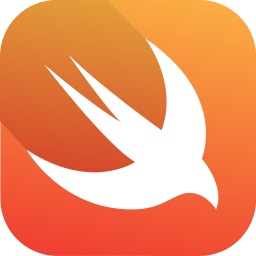

### 📫 Contact

- Email: xichenglzp@foxmail.com

---

### 🚀 About Me

- 🌐 **Frontend Enthusiast** – I love working with modern web technologies like React and Vue.
-  **Exploring Swift** – Built apps using Swift technologies.
- 🛠️ **Tool Creator** – Passionate about building tools to solve problems in work, study, and entertainment.
- 🎯 **Lifelong Learner** – Always exploring new technologies and staying updated with industry trends.

---

### 💻 Portfolio

-  [Dockit](https://github.com/XiCheng148/Dockit)
  A tool for macOS that allows you to dock any window to the edge of the screen and quickly recall it by hovering the mouse.

- 🔗 [SmartPreview](https://github.com/XiCheng148/SmartPreview)
  A browser extension that allows you to preview the content of links on a webpage without opening a new tab.

- 🙊 [MuteApp](https://github.com/XiCheng148/MuteApp)
  MuteApp is a simple tool that allows you to quickly mute/unmute the currently active window using a hotkey.

- 📢 [CodeRadio](https://github.com/XiCheng148/CodeRadio)
  A menu bar music radio client for [freecodecamp](https://coderadio.freecodecamp.org), written in Swift.

---

---

### 📊 GitHub Stats

---

Welcome, You are my  visitor, Thank You!🎉🎉

---
